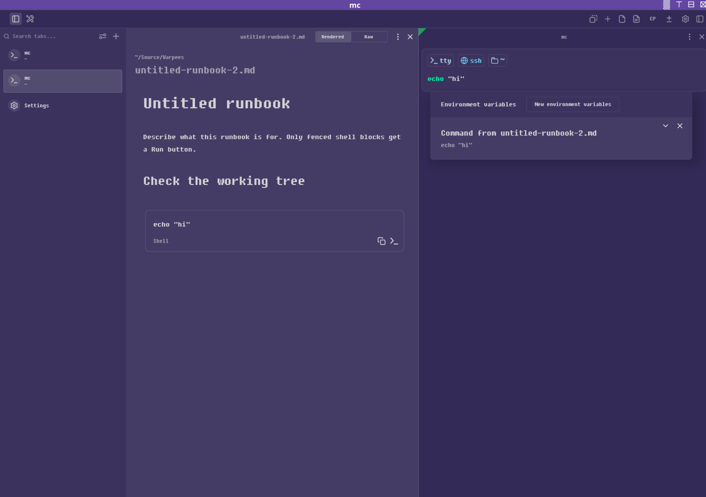
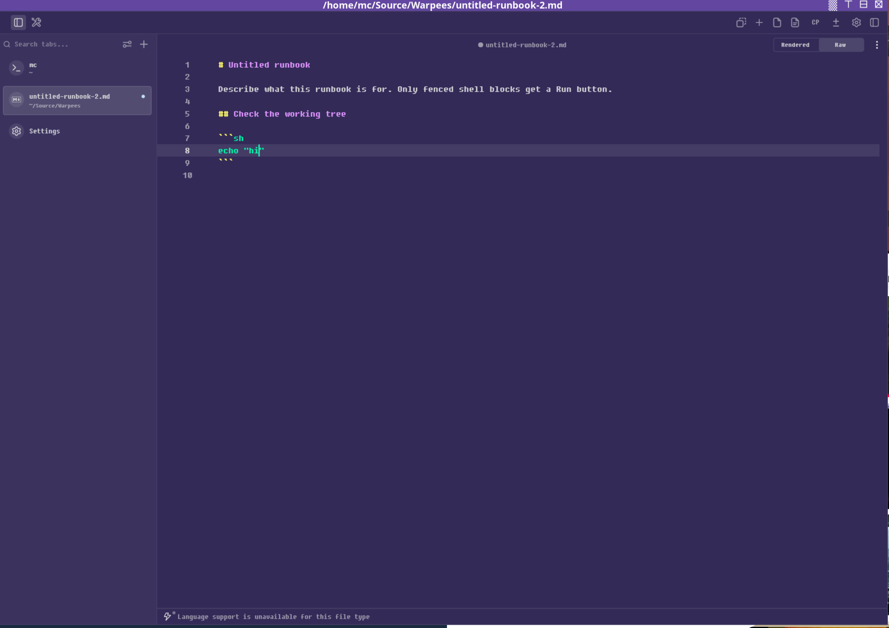
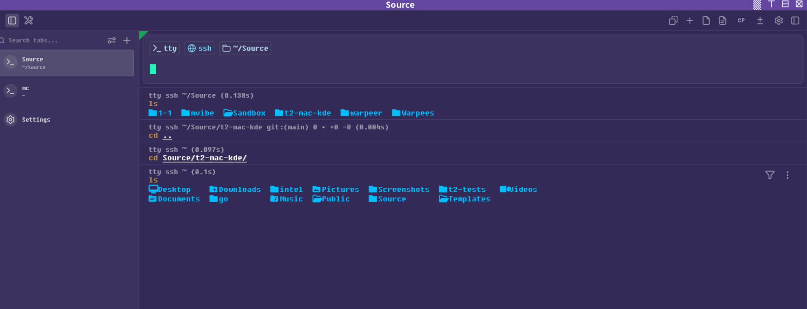

_ prompt on a dark tile" width="96">

# Cyberterm 2077

Cyberterm 2077 is a desktop terminal that runs your Markdown runbooks. Write the
steps of a deployment as a `.md` file, keep it in Git next to your Terraform,
Ansible or PowerShell DSC code, and step through it in Bash, Zsh, Fish or
PowerShell. Each step goes into your terminal's input line and runs when you
press Enter. It doesn't talk to a cloud service.



## Status: personal fork, no warranty

This is my personal fork of the open-source [Warp](https://github.com/warpdotdev/warp)
terminal, formerly called Warpeer. It comes with no warranty, no support and no
roadmap. I build it because I run systems where a terminal can't have accounts,
subscriptions or nag screens. If you want to support the people who built the
terminal underneath, buy [Warp](https://www.warp.dev/terminal).

It is not affiliated with Warp (Denver Technologies, Inc.) or with any game
publisher.

## Why runbooks in a terminal

Most ops teams already write runbooks in Markdown: in a wiki, a README or a
`docs/` folder. During an incident someone copies commands out of a browser tab,
edits a hostname by hand and hopes the page is still current. Notebook tools that
fix this usually want an account and a cloud workspace, which many environments
don't allow.

Cyberterm 2077 keeps the runbook as a plain file and makes it executable where
you already work. The file diffs, reviews and merges like any other Markdown in
the repo; there is no export format or database behind it.

Clicking "Run in terminal" puts the command into the terminal input, where you
can read it and fix the hostname before you press Enter. I wanted that pause.
Opening or browsing a runbook never executes anything.

The command runs in the session you already have open, with your PATH,
credentials and kube context, in Bash, Zsh, Fish or PowerShell. There is no
sign-in, telemetry, crash reporting, hosted AI or sync. The one network request
the app makes by itself is described under [Network use](#network-use).

## First runbook in five minutes

1. Install a build (see [Install](#install)) and start it.
2. Click **New Runbook** (the notebook icon next to New File in the toolbar).
   The first time, pick a folder for your runbooks, for example `~/Runbooks`.
3. The new `untitled-runbook.md` opens in the notebook viewer. Click **Raw** to
   edit it, and replace the example with a real step:

   ````markdown
   # Plan the staging network

   Check that you are in the right workspace first.

   ```bash
   terraform -chdir=infra/network workspace show
   ```

   ```bash
   terraform -chdir=infra/network plan -out=staging.tfplan
   ```
   ````

   

4. Switch back to **Rendered**. Each fenced block now has a **Run in terminal**
   button. You can also select a block and press Ctrl+Enter, and move between
   blocks with Ctrl+Up and Ctrl+Down.
5. Click it, read the command in the terminal input and press Enter.

Rename the file when you are done, for example
`mv ~/Runbooks/untitled-runbook.md ~/Runbooks/staging-network-plan.md`.

## Writing runbooks

A block is runnable when its fence is tagged `sh`, `shell`, `bash`, `zsh`,
`fish`, `pwsh`, `powershell` or `ps1`. Any other block (YAML, HCL, JSON) is shown
with syntax highlighting but no Run button, which is useful for showing config
next to the command that applies it. A command written in a normal paragraph is
just text.

The tag only decides whether a block gets the button. The command goes to
whatever shell the active terminal runs, so a `powershell` block belongs in a
runbook you step through from a PowerShell tab.

Write `{{name}}` in a command to mark a value that changes between runs, such as
an environment or a host. These placeholders become workflow arguments that you
fill in before pressing Enter.

Some habits that keep runbooks useful:

- One task per file, with a `#` title that says what it does.
- Prerequisites and checks in prose, before the first command.
- One command per block, so each step can be read and run on its own.
- A dry run first: `plan`, `--check`, `Test-`, then the real change.

### Terraform

````markdown
# Apply the {{env}} network

```bash
terraform -chdir=infra/network workspace select {{env}}
```

```bash
terraform -chdir=infra/network plan -out={{env}}.tfplan
```

Read the plan. Apply only that saved plan:

```bash
terraform -chdir=infra/network apply {{env}}.tfplan
```
````

### Ansible

````markdown
# Patch the web tier

```bash
ansible-playbook -i inventories/{{env}} patch-web.yml --check --diff
```

If the diff looks right, run it for real, one host at a time:

```bash
ansible-playbook -i inventories/{{env}} patch-web.yml --forks 1
```
````

### PowerShell Desired State Configuration

````markdown
# Converge the IIS baseline

```powershell
. .\WebBaseline.ps1; WebBaseline -OutputPath .\out\WebBaseline
```

```powershell
Test-DscConfiguration -Path .\out\WebBaseline -Verbose
```

```powershell
Start-DscConfiguration -Path .\out\WebBaseline -Wait -Verbose
```
````

## Organizing runbooks

Keep one folder per scope and register each one, either with **Add local
runbook folder** in the command palette or in `settings.toml`:

```text
~/Runbooks/                        personal, cross-project
  git/cleanup-branches.md
  k8s/restart-deployment.md
~/Source/platform/runbooks/        reviewed in Git with the code it operates
  network/apply.md
  web/patch.md
```

```toml
[runbooks]
folders = ["~/Runbooks", "~/Source/platform/runbooks"]
```

- **New Runbook** writes into the first folder in the list, so put your default
  folder first. Existing files are never overwritten; the next new runbook is
  `untitled-runbook-2.md`.
- **Browse local runbooks** searches every registered folder and its
  subfolders by path, so folder names work as tags: type `k8s` to list
  everything under `k8s/`.
- Put team runbooks in the repository they belong to and change them through
  pull requests. Register the `runbooks/` folder, not the whole repository,
  because scans are bounded.

On Linux `settings.toml` is `~/.config/warpeer/settings.toml`. See
[local runbooks](docs/local-runbooks.md) for scan limits and path rules.

**New File** opens a plain editor, not a runbook. A file you write there gets Run
buttons once it is saved as `.md` in a runbook folder and opened through Browse
local runbooks.

## The terminal

Apart from runbooks, Cyberterm 2077 keeps most of Warp's local terminal:

- GPU-rendered terminal with IME support
- Tabs, vertical tabs, split panes and saved pane layouts
- Command history, completions, global search and a code review view
- A command palette (**CP** in the toolbar) for every action
- Tab privacy with biometric unlock and pane previews
- A control center for local CLI agents working in Git worktrees
- Toolbar buttons for New Window, New Tab, New File and New Runbook
- 600+ bundled color themes, including **Cyberterm Neon**



### Theme and fonts

Open the theme chooser (from Settings or the command palette) and pick
**Cyberterm Neon**. It is a dark violet theme with cyan, magenta and yellow
accents. Every ANSI color except black, which is meant as a background, has at
least 4.5:1 contrast against it.

Fonts are not bundled. Install any font you like and set it for the terminal,
the editor and Markdown, and the menus and tabs:

```toml
[appearance.text]
font_name = "JetBrains Mono"
ai_font_name = "JetBrains Mono"
ui_font_name = "Rajdhani"
```

`ui_font_name = ""` uses the platform default, and a missing font falls back to
it. Free fonts that fit the look include Share Tech Mono and JetBrains Mono for
the terminal and Rajdhani or Orbitron for the UI.

## Install

This is personal-use software for people who can judge what they run, not an
installer for general users. I don't hold an Apple Developer ID or a Windows
code signing certificate, so macOS and Windows will warn you. That is expected.
If you aren't comfortable checking a download yourself and overriding those
warnings, don't install it.

Builds come from GitHub Actions for Linux x86-64, Windows x86-64 and macOS on
Apple Silicon. Download them from
[Releases](https://github.com/norandom/Cyberterm-2077/releases).

Each artifact has a `.sha256` file. Check it before you open anything:

```sh
sha256sum -c cyberterm2077-linux-x86_64.tar.gz.sha256      # Linux
shasum -a 256 -c cyberterm2077-macos-aarch64.dmg.sha256     # macOS
```

```powershell
(Get-FileHash .\cyberterm2077-windows-x86_64-setup.exe -Algorithm SHA256).Hash   # compare with the .sha256 file
```

Release artifacts are also signed with this project's own release key
(`cyberterm2077-release.pub` in each release). That signature is what the
built-in updater checks. You can check it yourself with
[zipsign](https://crates.io/crates/zipsign) (`cargo install zipsign --version 0.2.2`); the
`.tar.gz` and `.zip` carry their signature inside, the other files have a
`.sig` next to them:

```sh
zipsign verify separate cyberterm2077-macos-aarch64.dmg cyberterm2077-macos-aarch64.dmg.sig cyberterm2077-release.pub
zipsign verify tar cyberterm2077-linux-x86_64.tar.gz cyberterm2077-release.pub
```

The signature is not an Apple or Microsoft signature, so it does
nothing for Gatekeeper or SmartScreen.

### Linux

Install `cyberterm2077-linux-x86_64.deb`, or extract the `.tar.gz` and run
`./cyberterm2077`. Builds target Ubuntu 24.04 (glibc 2.39 or newer) and need a
graphical session, fontconfig, ALSA, X11 or Wayland and a working GPU driver.

### macOS

The app is ad-hoc signed and not notarized, so Gatekeeper blocks the first
launch with a message that Apple could not check it for malicious software.
Open the DMG, copy Cyberterm 2077 to Applications, then remove the quarantine
flag that the browser set on the download:

```sh
xattr -dr com.apple.quarantine "/Applications/Cyberterm 2077.app"
```

After that it starts normally. Alternatively, try to open it once, then use
System Settings > Privacy & Security > Open Anyway.

### Windows

The installer and executable are unsigned, so Microsoft Defender SmartScreen
shows "Windows protected your PC" on first run. Click **More info**, then
**Run anyway**. That warning is expected here; it only says the file has no
known publisher.

The installer is per-user and doesn't ask for administrator rights. If you use
the zip instead, unblock the downloaded file before extracting it, so Windows
doesn't flag every file inside:

```powershell
Unblock-File .\cyberterm2077-windows-x86_64.zip
```

### Upgrading from Warpeer

The binary is now `cyberterm2077`. Settings, history and runbook folders stay
where they were: data still lives in the `warpeer` directories (`~/.warpeer`,
`~/.config/warpeer`, `~/.local/state/warpeer` on Linux), so a new install picks
them up. Warpeer v0.1.5 and older can't update themselves to the new name.
Install Cyberterm 2077 once by hand; the `.deb` replaces the `warpeer` package.

## Network use

Cyberterm 2077 makes one kind of request on its own: once a day it asks this
repository's GitHub Releases whether a newer signed version exists. It
downloads and installs an update only when you click to apply it, and it checks
the signature first. `.deb` installs never self-update; use your package
manager. Everything else that touches the network is something you run in the
terminal.

## Build from source

The toolchain is pinned in `rust-toolchain.toml`. Native build dependencies are
listed in `.github/workflows/build-desktop.yml`. You also need `protoc` (on
Debian and Ubuntu, `apt install protobuf-compiler`).

```sh
CARGO_FULL_PROFILE=release-desktop CARGO_BIN_NAME=cyberterm2077 WARP_APP_NAME="Cyberterm 2077" \
  cargo build --locked -p warp --bin cyberterm2077 --no-default-features --features warpeer --profile release-desktop
python3 script/warpeer/package-desktop.py linux # or windows / macos
```

Build GUI binaries with your system toolchain. A binary built inside
`nix develop` links against Nix's glibc and can't load the system's X11 and
Wayland libraries. If your shell sets `CC` to another compiler such as Intel's
`icx`, build with `CC=gcc CXX=g++`.

The internal Cargo feature, crates and scripts still use the old `warpeer`
name. Before sending changes, check the product profile:

```sh
./script/verify-warpeer-profile
```

## License

Cyberterm 2077 is a modified version of Warp. The `warpui_core` and `warpui`
crates are licensed under the [MIT license](LICENSE-MIT). All other code is
licensed under the [GNU Affero General Public License v3.0](LICENSE-AGPL). See
[NOTICE](NOTICE) for attribution.

"Warp" is a trademark of its respective owner.
